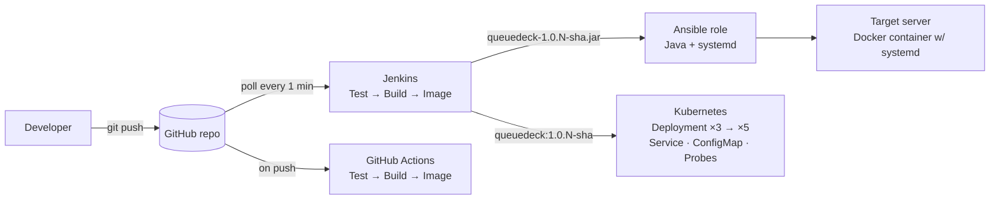

# QueueDeck: CI/CD Pipeline & Kubernetes Deployment

**QueueDeck** is a small REST API that simulates a bounded job queue with a pluggable dequeue order (**FIFO**, **LIFO** or **priority**).
A full queue answers 429 instead of dropping work, and stats report depth, rejections and the order jobs will run in.
The same JAR goes through one pipeline end to end:



| Component | What's in this repo |
|---|---|
| App | Spring Boot 3 / Java 17, 4 API endpoints + actuator, in-memory, no DB |
| Build | Maven (`pom.xml`), CI-friendly `${revision}` version |
| CI | `Jenkinsfile` (SCM polling, Test stage, archived artifact) + `.github/workflows/ci.yml` |
| **CI enhancements** | ① JUnit **test stage** before build ② **versioned artifacts**: `queuedeck-1.0.<build>-<sha>.jar` and the Docker image tagged the same way ③ **GitHub Actions** alongside Jenkins |
| Config mgmt | `ansible/`: inventory, playbook, **role** `queuedeck` (variables, **handler**, templates), plus `ansible/target/Dockerfile` for the systemd target container |
| Container | Multi-stage `Dockerfile` (Maven build stage → JRE-only runtime, non-root) |
| Kubernetes | `k8s/`: Deployment (3 replicas), NodePort Service, ConfigMap, optional HPA |
| **Deploy enhancements** | ① **rollback demo** (`scripts/rollback-demo.sh`) ② **ConfigMap** for runtime settings ③ **startup/liveness/readiness probes** ④ **multi-stage Dockerfile** ⑤ **/actuator/health + /actuator/prometheus metrics** |

## API

| Method | Path | Description |
|---|---|---|
| GET | `/` | Version and **which pod answered** (`instance`) |
| POST | `/api/jobs` | Body `{"name":"...","priority":0-9}` → 201, or **429** when the queue is full |
| POST | `/api/jobs/next` | Dequeue the next job per the policy: 200, or 404 when empty |
| GET | `/api/stats` | policy, capacity, depth, enqueued, rejected, dequeued, dequeueOrder |
| DELETE | `/api/jobs` | Clear the queue |
| GET | `/actuator/health`, `/actuator/health/{liveness,readiness}` | Health for probes |
| GET | `/actuator/prometheus` | `queuedeck_enqueued_total`, `queuedeck_rejected_total`, `queuedeck_dequeued_total`, `queuedeck_depth` |

Configuration (env vars): `APP_PORT` (8080), `QUEUE_POLICY` (`FIFO`/`LIFO`/`PRIORITY`), `QUEUE_CAPACITY` (≥1, validated at startup).

## Quick start

```bash
mvn clean verify                                   # 9 JUnit tests + JAR in target/
java -jar target/queuedeck-1.0.0-SNAPSHOT.jar
scripts/smoke-test.sh http://localhost:8080
```

The full walkthrough (Git → Jenkins → Ansible → Docker → Kubernetes, plus a screenshot checklist) is in [`docs/RUNBOOK.md`](docs/RUNBOOK.md).

## Design note: why each pod keeps its own state

Every replica keeps its own queue, so after scaling to 5 pods a job enqueued on pod A can't be dequeued through pod B (and a restart loses it)
(`scripts/spread.sh` shows the Service spreading requests across pods). This is on purpose. It shows why production
services keep pods **stateless** and put shared state in a broker such as Redis, RabbitMQ or SQS, which is the obvious next step for this project.

## Branches & Pull Requests

Work is done on feature branches and merged into `main` through pull requests (merge commits kept). See `docs/RUNBOOK.md` §2.

| PR | Branch | What it adds |
|---|---|---|
| #1 | `feature/ci-pipeline` | CI pipeline: Jenkins + GitHub Actions |
| #2 | `feature/deploy` | Deployment: Ansible + Docker + Kubernetes |

View the graph: **Insights → Network** on GitHub, or `git log --oneline --graph --all`.
